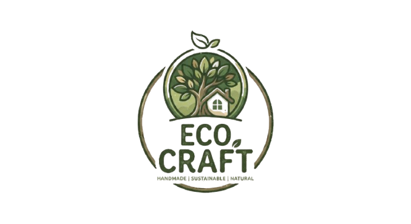

<div align="center">
  

  # EcoCraft

  **Ubah barang bekas menjadi kreasi berdaya guna.**

  Inspirasi DIY, cerita ramah lingkungan, dan langkah sederhana untuk bumi yang lebih lestari.

  <br />

  
  
  
</div>

---

## Tentang EcoCraft

EcoCraft adalah website inspirasi daur ulang yang membantu siapa saja melihat potensi baru pada barang bekas. Temukan ide berdasarkan bahan, ikuti panduan pembuatan, dan mulai kebiasaan ramah lingkungan dari rumah.

## Jelajahi fitur

| Fitur | Yang bisa dilakukan |
| --- | --- |
| **Beranda** | Menjelajahi ide DIY unggulan dan menghitung estimasi dampak daur ulang. |
| **Katalog DIY** | Mencari tutorial, memfilter berdasarkan bahan, melihat alat dan bahan, serta mengikuti langkah pembuatan. |
| **Video panduan** | Menonton video YouTube pada detail tutorial saat tautan video tersedia. |
| **Artikel** | Mencari dan membaca artikel yang dipublikasikan melalui panel admin. |
| **Tentang EcoCraft** | Mengenal deskripsi, visi, dan misi EcoCraft. |
| **Kontak** | Menyusun pesan melalui aplikasi email yang tersedia di perangkat. |
| **Panel admin** | Menambah, melihat, mengedit, dan menghapus tutorial DIY serta artikel, termasuk mengunggah gambar dari perangkat. |

## Tampilan

<div align="center">
  
</div>

## Mulai menggunakan

### Persyaratan

- Node.js `20.19+` atau `22.12+`
- npm

### Instalasi

```bash
git clone https://github.com/NadzifHasan2005/Eco-Craft.git
cd Eco-Craft
npm install
npm run dev
```

Buka URL yang ditampilkan Vite di terminal, biasanya `http://localhost:5173/Eco-Craft/`.

### Panel admin demo

Buka [`http://localhost:5173/Eco-Craft/admin`](http://localhost:5173/Eco-Craft/admin), lalu masuk dengan akun demo:

| Email | Password |
| --- | --- |
| `admin@ecocraft.id` | `admin123` |

> **Penting:** autentikasi demo saat ini berjalan di frontend dan bukan perlindungan yang aman. Jangan gunakan kredensial ini untuk data sensitif atau produksi. Gunakan autentikasi backend sebelum menerbitkan website.

## Perintah yang tersedia

| Perintah | Keterangan |
| --- | --- |
| `npm run dev` | Menjalankan server pengembangan Vite. |
| `npm run build` | Membuat build produksi ke `dist/`. |
| `npm run preview` | Meninjau build produksi secara lokal. |
| `npm run lint` | Menjalankan pemeriksaan Oxlint. |

## Konten dan penyimpanan

- Tutorial bawaan dimuat dari `src/data/kreasiData.js`.
- Perubahan tutorial dan artikel admin disimpan di `localStorage` browser dengan kunci `ecocraft-content-v1`.
- Gambar yang diunggah dikompres dan disimpan bersama konten di browser. Gunakan gambar JPEG, PNG, atau WebP hingga 15 MB; data tidak tersinkron ke perangkat lain.
- Data tersimpan hanya di browser dan perangkat saat ini; belum ada sinkronisasi server atau antarperangkat.
- Penghapusan konten bersifat permanen pada browser tersebut kecuali ada cadangan.
- Form kontak menyiapkan tautan `mailto`; pengiriman pesan dilakukan melalui aplikasi email pengguna, bukan oleh server EcoCraft.

## Struktur proyek

```text
src/
├── admin/
│   ├── AdminLogin.jsx      # Login admin
│   ├── AdminPanel.jsx      # Layout dan navigasi panel admin
│   ├── AdminDashboard.jsx  # Ringkasan dan statistik konten
│   ├── AdminArtikel.jsx    # CRUD artikel
│   └── AdminKatalog.jsx    # CRUD katalog tutorial DIY
├── assets/      # Logo dan gambar
├── data/        # Tutorial DIY bawaan
├── utils/       # Helper, termasuk validasi tautan YouTube
├── App.jsx      # State aplikasi dan pemilihan halaman
├── Artikel.jsx  # Daftar dan detail artikel
├── Home.jsx     # Beranda dan kalkulator dampak
├── Katalog.jsx  # Katalog tutorial DIY
├── Kontak.jsx   # Formulir kontak
└── Tentang.jsx  # Deskripsi, visi, dan misi EcoCraft
```

## Build dan deployment

Buat dan tinjau build lokal:

```bash
npm run build
npm run preview
```

### GitHub Pages

Proyek ini dikonfigurasi untuk GitHub Pages pada repositori `Eco-Craft`:

**https://nadzifhasan2005.github.io/Eco-Craft/**

Setiap push ke branch `main` akan menjalankan workflow GitHub Actions untuk memasang dependensi, memeriksa lint, membuat build, dan menerbitkan folder `dist/`. Workflow juga membuat fallback `404.html` agar halaman React seperti `/admin` tetap dapat dimuat ulang di GitHub Pages.

Jika Pages belum aktif pada repositori, buka **Settings → Pages**, lalu pilih **GitHub Actions** sebagai sumber deployment. Status build dan deployment dapat dilihat pada tab **Actions** di GitHub.

---

<div align="center">
  Dibuat dengan semangat daur ulang 🌱
</div>
